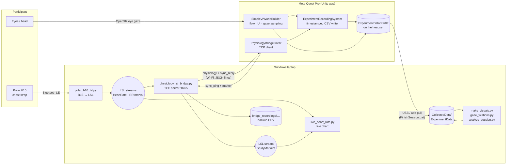
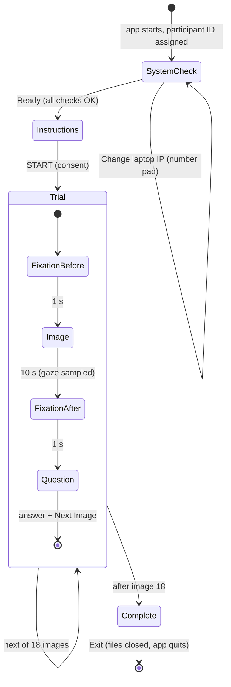
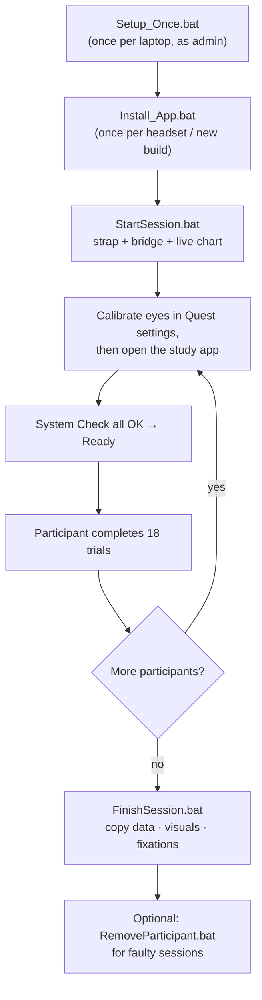

# VR Street-Safety Perception Study — Eye Tracking + Heart Rate Data Collection

A complete, self-contained research system that shows participants 360° street panoramas in a **Meta Quest Pro** headset, asks how safe each place feels, and records — on one shared clock — **where they look** (eye tracking), **their heart rate and beat-to-beat intervals** (Polar H10 chest strap), and **every experiment event**. After each session, laptop tools copy the data off the headset and produce heatmaps, scan paths, fixation statistics and heart-rate charts automatically.

This document is the technical reference for the whole project: architecture, workflow, setup, every output file and column, the analysis methods and the exact parameter values they use, development decisions, and known limitations.

> **Running sessions day to day?** Use the operator sheet **[README_CLIENT.md](README_CLIENT.md)** — it is written for non-technical staff and needs no Unity knowledge. This README explains *how and why* everything works.

---

## Contents

1. [Study at a glance](#1-study-at-a-glance)
2. [Hardware and software](#2-hardware-and-software)
3. [Repository layout](#3-repository-layout)
4. [System architecture](#4-system-architecture)
5. [Experiment workflow](#5-experiment-workflow)
6. [Timing and clock synchronisation](#6-timing-and-clock-synchronisation)
7. [Setup](#7-setup)
8. [Running a session](#8-running-a-session)
9. [Output data reference](#9-output-data-reference)
10. [Analysis methods and metrics](#10-analysis-methods-and-metrics)
11. [Data-quality criteria](#11-data-quality-criteria)
12. [Configuration reference (all values used)](#12-configuration-reference-all-values-used)
13. [Development methods and design decisions](#13-development-methods-and-design-decisions)
14. [Changing the experiment](#14-changing-the-experiment)
15. [Known limitations and caveats](#15-known-limitations-and-caveats)
16. [Troubleshooting](#16-troubleshooting)
17. [Related documents](#17-related-documents)

---

## 1. Study at a glance

| Item | Value |
|---|---|
| Stimuli | **18** equirectangular 360° street panoramas (`Pano001`–`Pano018`), 2 per location, 9 locations in Kollam |
| Per-trial sequence | Fixation cross **1 s** → panorama **10 s** → fixation cross **1 s** → rating question (self-paced) |
| Question (every image) | *"How safe do you feel in this alley (or street corridor)?"* |
| Response scale | 5-point: `1 - Very unsafe`, `2 - Unsafe`, `3 - Uncertain (neutral)`, `4 - Safe`, `5 - Very safe` |
| Image order | Fixed (Pano001 → Pano018), identical for every participant |
| Eye tracking | Quest Pro eye gaze via OpenXR, sampled **every 0.05 s** during the image (≈18 Hz effective, 180 samples per 10 s image) |
| Heart rate | Polar H10: heart rate (bpm, ≈1 Hz) and RR intervals (ms, every beat) |
| HR recording window | From the first fixation cross to the end of the second, per trial (≈12 s per image) |
| Typical session length | ≈4.5–5.5 minutes of experiment (measured 269–447 s across P001–P014), plus setup |
| Participant IDs | Automatic: `P001`, `P002`, … (next number after the highest existing folder) |
| Optional extras (off) | 1–9 comfort rating at start and end of the session (`Ask Comfort Questions`) |

Panorama locations (from [Assets/Images_Pano/image_index.csv](Assets/Images_Pano/image_index.csv)):

| Trials | Location |
|---|---|
| Pano001–002 | Asramam |
| Pano003–004 | Bridge below TKM front gate |
| Pano005–006 | Chinnakada active street |
| Pano007–008 | Kollam Beach Road |
| Pano009–010 | Peerangi Mydan, Kollam |
| Pano011–012 | Shankers Rd railway station |
| Pano013–014 | Taluk Kachery |
| Pano015–016 | WE Park |
| Pano017–018 | WE Park opposite side |

---

## 2. Hardware and software

### Hardware

| Device | Role |
|---|---|
| **Meta Quest Pro** | Displays the study, tracks the eyes, records all data locally |
| **Polar H10** chest strap (sensor ID `1B77F535` configured) | Heart rate and RR intervals over Bluetooth Low Energy |
| **Windows laptop** with Bluetooth | Connects to the strap, relays heart rate to the headset, collects and analyses data |
| Wi-Fi network | Headset and laptop must be on the same network and able to reach each other (phone hotspot / own router recommended) |
| USB-C cable | Installing the app and copying data off the headset (adb) |

### Software

| Layer | Technology / version |
|---|---|
| Game engine | **Unity 6000.4.8f1** (Unity 6.4), Universal Render Pipeline 17.4 |
| XR | OpenXR 1.16.1, Unity OpenXR: Meta 2.5.1, XR Interaction Toolkit 3.4.1, Input System 1.19 |
| Eye gaze | OpenXR **Eye Gaze Interaction Profile** (enabled for Android), input path `<EyeGaze>/pose` |
| Android build | Package `com.DefaultCompany.VRTemplate`, min SDK 32, ARM64, IL2CPP |
| Laptop runtime | Python 3 (Anaconda preferred automatically if installed) |
| Python packages | `pylsl` (Lab Streaming Layer), `bleak` (Bluetooth LE), `numpy`, `scipy`, `matplotlib`, `pillow` |
| Device tooling | Android `adb` (from PATH, or the copy bundled with the Unity Hub Android module) |

---

## 3. Repository layout

```
DataCollectionProject/
├── README.md                     ← this document (technical reference)
├── README_CLIENT.md              ← step-by-step operator instructions
├── EXPERIMENT_SETUP.md           ← Unity-side configuration notes
├── EXPERIMENT_INTEGRATION.md     ← original LSL/bridge design notes (partly superseded, see §17)
│
├── Setup_Once.bat                ← once per laptop: Python packages + firewall rule
├── Install_App.bat               ← installs the newest build\*.apk on the headset
├── StartSession.bat              ← starts strap streamer, bridge and live HR window
├── FinishSession.bat             ← copies data off the headset, makes pictures + fixations
├── RemoveParticipant.bat         ← removes a faulty session and rebuilds Combined data
│
├── Assets/
│   ├── Scenes/BasicScene.unity           ← the only build scene; holds all trial settings
│   ├── Images_Pano/Dissertation Ansif/   ← the 18 panoramas, one folder per location
│   ├── Images_Pano/image_index.csv       ← trial name ↔ location ↔ original photo file
│   └── Scripts/
│       ├── SimpleVrWorldBuilder.cs       ← experiment controller: UI, flow, gaze sampling, CSV/heatmap export
│       ├── QuestEyeTrackingPermission.cs ← asks for the eye-tracking permission at launch
│       ├── Editor/EyeTrackingManifestPostprocessor.cs ← adds the permission to the Android manifest
│       └── ExperimentData/
│           ├── ExperimentRecordingSystem.cs ← timestamped, thread-safe writer for gaze / HR / events
│           └── PhysiologyBridgeClient.cs    ← headset-side TCP client: HR in, clock sync, markers out
│
├── Tools/
│   ├── polar_h10_lsl.py          ← Polar H10 (Bluetooth) → LSL streams HeartRate, RRinterval
│   ├── physiology_lsl_bridge.py  ← LSL → TCP to the headset; clock sync server; StudyMarkers stream
│   ├── live_heart_rate.py        ← live experimenter chart (HR, contact check, image bands)
│   ├── make_visuals.py           ← heatmap overlays, scan paths, heart-rate charts
│   ├── gaze_fixations.py         ← offline I-DT fixation detection + per-image summary
│   ├── analyze_session.py        ← merged timeline (synchronized.csv) + RR/HRV summary
│   ├── remove_participant.py     ← list / remove participants, rebuild Combined
│   └── get_laptop_ip.ps1         ← prints the laptop's LAN IPv4 address
│
├── build/                        ← APK builds (EyeTracking_v0.0.N.apk); newest is installed
├── CollectedData/ExperimentData/ ← results copied from the headset (P001/, P002/, …, Combined/)
└── bridge_recordings/<date_time>/physiology_bridge_backup.csv ← laptop-side backup of every HR/RR sample + markers
```

`Assets/Excite-O-Meter`, `Assets/VRTemplateAssets`, `Assets/XRI`, `Assets/Samples` and `Assets/OldTestImages` are third-party / template / legacy assets. They are not used by the study flow (the Excite-O-Meter Windows app was replaced by `polar_h10_lsl.py`, see §13).

---

## 4. System architecture

### 4.1 Components and data flow



### 4.2 Responsibilities

| Component | Runs on | What it does |
|---|---|---|
| `polar_h10_lsl.py` | Laptop | Scans for the Polar H10 by name, subscribes to the standard BLE Heart Rate Measurement characteristic (`0x2A37`), decodes bpm and RR intervals (1/1024 s units → ms), and publishes two LSL streams: `HeartRate` (bpm) and `RRinterval` (ms). Reconnects automatically if the strap drops. |
| `physiology_lsl_bridge.py` | Laptop | Subscribes to the LSL streams, forwards every sample **with its original LSL timestamp** to the headset over TCP port 8765, answers clock-sync pings, republishes headset events as the LSL stream `StudyMarkers`, and writes a backup CSV of everything it saw. |
| `live_heart_rate.py` | Laptop | Experimenter display only (saves nothing): last 120 s of heart rate, big current value, skin-contact warning, blue bands while an image is on screen, and the participant's current phase. |
| `SimpleVrWorldBuilder.cs` | Headset | The experiment controller. Builds the world and UI at runtime, runs the System Check → Instructions → trials → Thank-you flow, samples gaze, and writes gaze/response CSVs and heatmaps when the session ends. |
| `ExperimentRecordingSystem.cs` | Headset | Single owner of the session's streaming files (`_gaze_lsl.csv`, `_heartrate.csv`, `_events.csv`, `_metadata.json`). Converts the headset's clock to LSL time, filters heart rate to each trial's window and labels its phase. Thread-safe queue, flushed every 25 records. |
| `PhysiologyBridgeClient.cs` | Headset | Background TCP client to the laptop: receives physiology, sends clock pings every 2 s, sends every logged event as a marker. Reconnects every 1 s if the link drops. Remembers the laptop IP on the headset. |
| `QuestEyeTrackingPermission.cs` + `EyeTrackingManifestPostprocessor.cs` | Headset / build | Declare and request `com.oculus.permission.EYE_TRACKING`. |
| Analysis tools | Laptop | Offline post-processing of the copied data (§10). |

### 4.3 Bridge protocol (TCP, newline-delimited JSON)

| Direction | `type` | Fields | Purpose |
|---|---|---|---|
| Laptop → headset | `physiology` | `stream`, `timestamp_lsl`, `heart_rate_bpm` / `rr_interval_ms` / `ecg_value`, `has_hr`, `has_rr`, `has_ecg` | One sensor sample with its source LSL timestamp |
| Headset → laptop | `sync_ping` | `quest_sent_monotonic` | Clock-sync request (every 2 s) |
| Laptop → headset | `sync_reply` | `quest_sent_monotonic`, `received_lsl`, `sent_lsl` | Laptop LSL time when the ping arrived / reply left |
| Headset → laptop | `marker` | `trial`, `marker`, `object_id`, `metadata` | Copy of each experiment event for the live view and backup |

Sending on the headset happens on a dedicated background thread with a bounded queue (500 messages) so a slow Wi-Fi link can never freeze the headset display.

---

## 5. Experiment workflow

### 5.1 Session flow (headset)



1. **System Check** (nothing saved). Shows the participant number and four live lines, refreshed 4× per second:
   - **Heart rate** — `OK – NN bpm` if a sample arrived in the last 5 s; `NO SKIN CONTACT` if bpm < 30; `NO DATA` otherwise.
   - **Clock sync** — `OK` once at least one clock-sync reply has been received.
   - **Eye tracking** — `OK` if the eye-gaze pose is tracked; `NOT TRACKED` / `NOT AVAILABLE` otherwise.
   - **Laptop IP** — editable with an on-screen number pad, validated as an IPv4 address and remembered on the headset.

   The page states in words whether all checks have passed. Only then should the operator press **Ready**.
2. **Instructions page** (larger text, ×1.45 scale) with study information and implied consent; the participant presses **START**. Recording begins here.
3. **18 trials**, each: white screen with a black cross (1 s) → panorama (10 s, the participant can look around freely) → cross (1 s) → question screen. The participant points with the controller ray, selects an answer (it turns grey), and presses **Next Image** (enabled only after an answer is selected).
4. **Experiment Complete** screen; **Exit** closes all files and quits the app.

### 5.2 Operator workflow (laptop)



### 5.3 Events recorded per session

Every state change is written to `P###_events.csv`. A complete 18-image session produces 165 events:

| Event | Count | `object_id` | `metadata` |
|---|---|---|---|
| `ExperimentStart` | 1 | | `unity_started` |
| `TrialStart` | 18 | image name | |
| `FixationShown` / `FixationHidden` | 36 / 36 | | `before_image` or `after_image` |
| `StimulusShown` | 18 | image name | `image_start_marker` |
| `StimulusHidden` | 18 | image name | `image_end_marker` |
| `UserInteraction` | 18 | image name | `question=1;answer=<option text>` |
| `TrialEnd` | 18 | image name | |
| `ExperimentComplete` | 1 | | `legacy_gaze_export_saved` |
| `ExperimentEnd` | 1 | | `unity_closed` |

(`StartingComfortAnswered` is added only when the optional comfort questions are switched on.)

---

## 6. Timing and clock synchronisation

The headset, the laptop and the strap each have their own clock. All data is brought into one time base — the **LSL clock of the laptop** (`pylsl.local_clock()`) — so gaze, events and heart rate can be aligned to within a few milliseconds.

### 6.1 Clocks used

| Clock | Where | Used for |
|---|---|---|
| LSL clock (`timestamp_lsl`) | Laptop | The common time base for all streaming files |
| Headset monotonic clock (`local_monotonic_s`) | Headset, `Stopwatch` started with the app | Raw headset time; fallback if sync is unavailable |
| Unity unscaled time (`trial_time_seconds`) | Headset | Seconds since the image appeared, in `P###_gaze.csv` |

### 6.2 Clock-offset estimation (NTP-style midpoint)

Every 2 seconds the headset sends a ping containing its monotonic time `t_q1`. The bridge replies with the LSL time it received the ping (`L_recv`) and sent the reply (`L_sent`). When the reply arrives at headset time `t_q2`:

```
offset_candidate = (L_recv + L_sent) / 2  −  (t_q1 + t_q2) / 2
offset           = candidate                         (first reply)
offset           = 0.8 × offset + 0.2 × candidate    (every later reply — exponential smoothing)
timestamp_lsl    = headset_monotonic + offset
```

Assuming roughly symmetric Wi-Fi delay, the error is bounded by half the round-trip time; smoothing removes jitter between pings. **Until the first reply arrives `timestamp_lsl` is left blank — never zero-filled** — so unsynchronised rows are easy to detect.

### 6.3 Heart-rate timestamps

- The strap sends one Bluetooth packet per ~second. `polar_h10_lsl.py` stamps the bpm with the packet's arrival time on the LSL clock.
- A packet may contain several RR intervals. The **last beat is stamped at arrival and earlier beats are back-dated** by the preceding RR durations, so each RR interval gets an approximately correct beat time.
- The bridge forwards samples with these original LSL timestamps, so Wi-Fi delay to the headset does **not** shift heart-rate times.

### 6.4 Heart-rate window and phase labelling

With `Record Physiology Only During Stimulus` on (default), the headset keeps only samples whose LSL timestamp falls inside each trial's window — opened just before the first cross appears and closed after the second cross disappears. Each kept sample is labelled by its own timestamp:

| `phase` | Rule |
|---|---|
| `fixation_before` | timestamp < image start |
| `image` | image start ≤ timestamp ≤ image end |
| `fixation_after` | timestamp > image end |

If the clock is not yet synchronised, the headset's receipt time is used instead (less accurate, since it includes network delay).

### 6.5 Gaze sampling rate

Gaze is sampled in Unity's frame loop at 72 fps: a new sample is taken on the first frame at least 0.05 s after the previous one. Because frames are ~13.9 ms apart, the effective rate is **≈18 Hz** (every 4th frame ≈ 55.6 ms) — e.g. 180 samples per 10 s image in P014. Fixation start/end times are therefore accurate to about ±50 ms.

---

## 7. Setup

### 7.1 Laptop (once)

1. Install Python 3 (Anaconda is detected automatically at `%USERPROFILE%\anaconda3\python.exe`; otherwise `python` on PATH is used).
2. Right-click **`Setup_Once.bat` → Run as administrator**. It:
   - installs `pylsl bleak numpy matplotlib pillow scipy`;
   - adds the Windows Firewall rule **"Study bridge 8765"** (inbound TCP 8765, private + public profiles).
3. Make sure Bluetooth is on and the **Excite-O-Meter app is closed** (it would hold the strap's connection; `StartSession.bat` also closes it).
4. If a different strap is used, edit `set "STRAP=1B77F535"` at the top of `StartSession.bat` (last 8 characters of the name printed on the sensor).

`adb` is taken from PATH, or from the Unity Hub Android module (`…\Hub\Editor\6000.4.8f1\Editor\Data\PlaybackEngines\AndroidPlayer\SDK\platform-tools\adb.exe`).

### 7.2 Headset (once)

1. Enable **Developer Mode** (Meta Horizon phone app → Devices → headset → Developer Mode).
2. In the headset: **Settings → Movement tracking → Eye tracking: On**.
3. Join the same Wi-Fi as the laptop.
4. Connect by USB, accept **Allow USB debugging → Always allow**, run **`Install_App.bat`** (installs the newest `build\*.apk` with `adb install -r`, keeping existing data).
5. First launch: choose **Allow** for eye tracking, then fully close and re-open the app once.

### 7.3 Developer setup (only to change or rebuild the app)

1. Install **Unity 6000.4.8f1** with the Android Build Support module (SDK/NDK/OpenJDK).
2. Open the project folder in Unity Hub, then open `Assets/Scenes/BasicScene.unity`.
3. Check **Project Settings → XR Plug-in Management → OpenXR → Android**: Meta Quest feature on, **Eye Gaze Interaction Profile enabled** (already enabled in the current project).
4. **File → Build Profiles → Android**, build to `build/EyeTracking_v0.0.N.apk` (increment N; current latest is v0.0.12).
5. Install with `Install_App.bat`. Never uninstall between participants (see §15).

To test in the Editor without a headset: press Play; the System Check uses `127.0.0.1` for the bridge, Enter presses Ready/Start/Next, and number keys 1–9 pick answers. Without eye tracking, head direction is recorded (`head_fallback`).

---

## 8. Running a session

The full step-by-step procedure, with the System Check table and troubleshooting, is in **[README_CLIENT.md](README_CLIENT.md)**. In short:

1. Wet and fit the Polar H10 strap.
2. Run **`StartSession.bat`** — three windows open: *Study – Polar H10* (`HR 72 bpm` lines), *Study – Bridge* (`Connected LSL stream: HeartRate`, then `Quest connected`), and *Live heart rate*. It prints the laptop's IP address.
3. Fit the headset, run the **eye calibration** in Quest settings, *then* open the study app.
4. On the System Check page, make sure all four lines are OK (correct the laptop IP if needed), press **Ready**.
5. The participant reads the instructions, presses **START**, and completes the 18 trials.
6. Press **Exit** at the end. Repeat 3–6 for the next participant.
7. Plug the headset in by USB and run **`FinishSession.bat`**: it closes the study windows, `adb pull`s all data into `CollectedData\ExperimentData`, runs `make_visuals.py` and `gaze_fixations.py`, and opens the results folder.
8. Faulty session? Run **`RemoveParticipant.bat`** (§9.5).

---

## 9. Output data reference

### 9.1 Where data lives

| Location | Path |
|---|---|
| Headset | `/sdcard/Android/data/com.DefaultCompany.VRTemplate/files/ExperimentData/` |
| Laptop (after FinishSession) | `CollectedData/ExperimentData/` |
| Unity Editor runs | `%USERPROFILE%\AppData\LocalLow\<Company>\<Product>\ExperimentData\` |
| Laptop backup of all strap data | `bridge_recordings/<yyyy-MM-dd_HHmm>/physiology_bridge_backup.csv` |
| Removed sessions | `CollectedData/_removed/<P###>_<yyyy-MM-dd_HHmm>/` |

```
ExperimentData/
├── P001/
│   ├── P001_metadata.json            ← written at START
│   ├── P001_events.csv               ← streamed during the session
│   ├── P001_gaze_lsl.csv             ← streamed during the session
│   ├── P001_heartrate.csv            ← streamed during the session
│   ├── P001_gaze.csv                 ← written at the END (complete sessions only)
│   ├── P001_responses.csv            ← written at the END
│   ├── P001_image_N_heatmap.csv/.png ← written at the END (N = 1…18)
│   ├── P001_image_N_overlay.png      ← make_visuals.py
│   ├── P001_image_N_scanpath.png     ← make_visuals.py
│   ├── P001_heartrate_trial_N.png    ← make_visuals.py
│   ├── P001_heartrate_all_trials.png ← make_visuals.py
│   ├── P001_fixations.csv            ← gaze_fixations.py
│   ├── P001_fixation_summary.csv     ← gaze_fixations.py
│   ├── P001_image_N_fixations.png    ← gaze_fixations.py
│   └── synchronized.csv, analysis_summary.json ← analyze_session.py (manual)
├── P002/ …
└── Combined/
    ├── combined_gaze.csv                     ← every participant's gaze rows appended
    ├── combined_image_N_heatmap.csv/.png     ← summed heatmap counts
    └── combined_image_N_overlay.png          ← make_visuals.py, all participants
```

A folder that has `_events.csv` / `_heartrate.csv` but **no `_gaze.csv`** is an **incomplete session** (the app was closed before the last trial).

### 9.2 Files written by the headset

All CSVs are UTF-8; text values are quoted. Blank cells mean "not available" (never a disguised zero).

#### `P###_gaze.csv` — gaze per sample, one row per sample during each image

| Column | Meaning |
|---|---|
| `participant_id` | e.g. `P014` |
| `starting_comfort_answer`, `ending_comfort_answer` | Optional 1–9 comfort ratings (blank when switched off) |
| `trial_index` | 1–18 |
| `image_name` | `Pano001` … `Pano018` |
| `trial_time_seconds` | Seconds since this image appeared |
| `gaze_valid` | `1` = real eye-tracking sample; `0` = eye tracking lost, head direction used |
| `gaze_source` | `eye_gaze` or `head_fallback` |
| `origin_x/y/z` | Gaze ray origin in world space (metres) |
| `direction_x/y/z` | Unit gaze direction in world space |
| `hit_x/y/z` | Point where the ray meets the panorama sphere (radius 15 m) |
| `pano_u`, `pano_v` | Gaze position on the panorama image, normalised 0–1 (u = horizontal, v = vertical, 0 = top) — see §10.1 |
| `question_1` | This participant's answer to the image's question, repeated on every row of the trial |

#### `P###_gaze_lsl.csv` — the same gaze samples on the shared clock

`timestamp_lsl, local_monotonic_s, participant_id, session_id, trial_id, gaze_valid, source, origin_x/y/z, direction_x/y/z, hit_x/y/z, hit_object, hit_instance_id`. Use this file to join gaze with heart rate and events.

#### `P###_heartrate.csv` — Polar H10 samples inside each trial window

| Column | Meaning |
|---|---|
| `timestamp_lsl` | Sensor time on the LSL clock (§6.3) |
| `received_local_monotonic_s` | Headset time the sample arrived |
| `participant_id`, `session_id`, `trial_id` | Identifiers (`trial_id` = 1–18) |
| `stream` | `HeartRate` or `RRinterval` (one value per row) |
| `heart_rate_bpm` | Beats per minute (HeartRate rows) |
| `rr_interval_ms` | Time between two beats in ms (RRinterval rows) |
| `ecg_value` | Always blank (raw ECG is not streamed) |
| `phase` | `fixation_before`, `image` or `fixation_after` (§6.4) |

#### `P###_events.csv` — every experiment event

`timestamp_lsl, local_monotonic_s, participant_id, session_id, trial_id, event_type, object_id, metadata` — see §5.3 for the event list.

#### `P###_responses.csv` — answers

`participant_id, starting_comfort_answer, ending_comfort_answer, trial_index, image_name, question_index, answer` — one row per answered question (18 rows). The answer is the full option text, e.g. `"4 - Safe"`; the leading digit is the numeric score.

#### `P###_image_N_heatmap.csv` / `.png` — coarse gaze heatmap made by the app

A 64 × 32 grid over the panorama (`u_index` 0–63, `v_index` 0–31, `count` = number of gaze samples in that cell). The PNG is a 256 × 128 transparent-to-red rendering of the same grid. For interpretation use the overlays from `make_visuals.py` instead (§15).

#### `P###_metadata.json`

`participant_id`, `session_id`, `unity_version`, `device_model`, `utc_started` (ISO 8601), `timestamp_note`, `physiology_scope`.

#### `Combined/`

`combined_gaze.csv` is every complete participant's `_gaze.csv` rows appended; `combined_image_N_heatmap.csv/.png` are the summed grid counts. These are updated by the app at the end of each session and rebuilt from scratch by `remove_participant.py`.

### 9.3 Files written by the laptop tools

| File | Tool | Content |
|---|---|---|
| `P###_image_N_overlay.png` | make_visuals | Smoothed gaze heatmap over the actual panorama |
| `P###_image_N_scanpath.png` | make_visuals | Gaze path in time order (○ = start, □ = end) |
| `P###_heartrate_trial_N.png` | make_visuals | HR over the trial with shaded fixation/image periods and start/end lines |
| `P###_heartrate_all_trials.png` | make_visuals | All 18 trial charts stacked |
| `Combined/combined_image_N_overlay.png` | make_visuals | All participants' gaze on one image |
| `P###_fixations.csv` | gaze_fixations | `trial_index, image_name, fixation_index, start_s, end_s, duration_s, samples, center_u, center_v, dispersion_deg` |
| `P###_fixation_summary.csv` | gaze_fixations | Per image: `samples, valid_eye_samples, valid_percent, fixation_count, mean_fixation_duration_s, total_fixation_time_s, fixations_per_second` |
| `P###_image_N_fixations.png` | gaze_fixations | Fixations as circles (size = duration, number = order) joined by saccade lines |
| `synchronized.csv` | analyze_session | Gaze, events and HR merged into one time-sorted table |
| `analysis_summary.json` | analyze_session | `rr_samples_valid, mean_rr_ms, rmssd_ms, sdnn_ms` |

### 9.4 Laptop backup file

`bridge_recordings/<date_time>/physiology_bridge_backup.csv` (`timestamp_lsl, stream, value`) contains **every** HeartRate and RRinterval sample the bridge received for the whole sitting (not only trial windows) plus `Marker` rows from the headset. It is an independent safety copy if headset data is lost, and a source for whole-session HR analysis. Marker times here are arrival times (offset by Wi-Fi delay); the headset's `_events.csv` is the exact record.

### 9.5 Removing a participant

`remove_participant.py` (via `RemoveParticipant.bat`):

1. pulls the newest data from the headset;
2. **moves** (never deletes) `P###` to `CollectedData/_removed/P###_<time>`;
3. deletes it from the headset;
4. rebuilds `Combined/` from the remaining complete participants — gaze rows and heatmap sums, byte-compatible with the app's own format — on the laptop and the headset.

`--list` shows each participant as `complete` / `INCOMPLETE (stopped early)` with the number of images answered and the start time; `--laptop-only` leaves the headset untouched. Participant numbers are not reused while a later number exists.

---

## 10. Analysis methods and metrics

### 10.1 Gaze → panorama coordinates

The panorama is drawn on the inside of a sphere centred on the participant's head (it follows the head position every frame, so the image never "moves" with head translation, only rotation). For a gaze direction `d = (x, y, z)` in the sphere's frame:

```
u = (0.5 + atan2(x, z) / 2π)  mod 1         horizontal: 0…1 across the full 360°
v = clamp(0.5 − asin(y) / π, 0, 1)          vertical:   0 = straight up, 0.5 = horizon, 1 = straight down
```

`(u, v)` maps directly to pixel `(u × width, v × height)` of the equirectangular image. If an overlay ever appears mirrored left/right, re-run the tools with `--flip-u`.

### 10.2 Gaze heatmap overlays (`make_visuals.py`)

| Step | Value |
|---|---|
| Grid | One cell per 4 × 4 image pixels |
| Samples used | All samples of the trial (eye **and** head-fallback); the title notes "head direction" if most samples were fallback |
| Smoothing | Gaussian, σ = 2 % of the image width, **wrapping horizontally** across the 360° seam |
| Normalisation | Divided by the per-image maximum (0–1) |
| Colour | `jet` colour map; transparency = min(1.6 × density, 0.85), cells below 0.04 fully transparent |
| Combined | Pools all participants' samples per image before smoothing |

Heatmaps show **relative dwell density** (where gaze spent most time), not absolute time.

### 10.3 Scan paths

Gaze samples in time order connected by lines; segments that cross the left/right image seam (|Δu| > 0.5) are not drawn so lines do not jump across the picture.

### 10.4 Fixation detection (`gaze_fixations.py`) — I-DT

Dispersion-Threshold Identification on the **3-D gaze direction vectors** (angular, so it is not distorted by the equirectangular projection):

| Parameter | Value | Option |
|---|---|---|
| Samples used | `gaze_valid = 1` only (head fallback excluded) | |
| Maximum dispersion | **1.5°** — every sample within 1.5° of the window's mean direction | `--dispersion-deg` |
| Minimum duration | **100 ms** | `--min-duration` |
| Maximum gap inside a fixation | max(2.5 × median sample interval, 0.15 s) | |
| Merging | Consecutive fixations whose centres are ≤ 1.5° apart and separated by ≤ the max gap are merged (removes splits caused by a single noisy sample) | |
| Duration | last sample − first sample + one sample interval | |

Algorithm: start a window at the current sample, grow it until it spans ≥ 100 ms; if dispersion ≤ 1.5°, keep extending it while dispersion stays ≤ 1.5° and there is no gap; record the fixation and continue after it; otherwise advance one sample.

### 10.5 Per-image eye-movement metrics (`P###_fixation_summary.csv`)

| Metric | Definition |
|---|---|
| `samples` | Gaze samples recorded during the 10 s image |
| `valid_eye_samples` | Samples with real eye tracking |
| `valid_percent` | 100 × valid / samples — **tracking quality** |
| `fixation_count` | Number of fixations |
| `mean_fixation_duration_s` | Average fixation length — longer = deeper processing of fewer elements |
| `total_fixation_time_s` | Sum of fixation durations |
| `fixations_per_second` | Fixation count ÷ trial span — exploration rate |

Per fixation (`P###_fixations.csv`): start/end/duration, number of samples, centre (`center_u`, `center_v`) and spatial `dispersion_deg`.

### 10.6 Heart-rate measures

| Measure | Source | Notes |
|---|---|---|
| Heart rate (bpm) per phase | `P###_heartrate.csv`, `stream = HeartRate`, grouped by `trial_id` × `phase` | ≈1 sample/s → ~1 value in each 1 s cross, ~10 during the image |
| RR interval (ms) | `stream = RRinterval` | One value per heartbeat |
| Image response | (mean HR during `image`) − (mean HR during `fixation_before`) per trial | Recommended derived measure; not computed automatically |
| Mean RR, RMSSD, SDNN | `analyze_session.py` | See below |

`analyze_session.py <participant folder>`:
- builds `synchronized.csv` — gaze (with the nearest preceding HR/RR sample and its phase), events and HR rows, sorted by `timestamp_lsl`;
- keeps RR intervals in the physiologically plausible range **300–2000 ms** (30–200 bpm) and computes:
  - **mean RR** = average interval;
  - **RMSSD** = √(mean of squared successive RR differences) — short-term (vagal) variability;
  - **SDNN** = sample standard deviation of RR — overall variability.

These are pooled over all trial windows of the participant (see §15 for caveats). The 300–2000 ms screen is deliberately conservative; replace it with the study's documented artefact policy before publication.

### 10.7 Subjective rating

The safety rating is the leading digit of the answer text (1 = very unsafe … 5 = very safe) in `P###_responses.csv` (or `question_1` in the gaze files). Across participants, `Combined/combined_gaze.csv` or concatenated `_responses.csv` files give a participant × image matrix for per-image mean ratings and their relationship with gaze and heart-rate measures.

### 10.8 Suggested analysis plan (beyond the automatic outputs)

1. **Exclusions:** drop incomplete sessions (§9.1) and trials with `valid_percent` < 80 for eye metrics; screen RR intervals for artefacts.
2. **Per image:** mean/median safety rating; fixation count, mean duration and fixations/s; HR change from baseline (image − fixation_before).
3. **Areas of interest:** define rectangles in (u, v) for features such as lighting, people, vehicles, walls; compute dwell time and time-to-first-fixation from `P###_fixations.csv`.
4. **Relationships:** mixed-effects models with participant and image as random effects, e.g. rating ~ fixation metrics, HR change ~ rating.
5. **Group maps:** `Combined/combined_image_N_overlay.png` for what most people looked at in each scene.

---

## 11. Data-quality criteria

| Check | Good | Action if not |
|---|---|---|
| System Check before Ready | Heart rate OK, Clock sync OK, Eye tracking OK | Do not start; fix first (README_CLIENT troubleshooting) |
| `valid_percent` per image | ≥ 80 % (all 252 image trials of P001–P014 were at 100 %; see §15 item 13) | Treat that image's eye metrics as unreliable; recalibrate before next participant |
| `gaze_valid` | `1` | `0` rows are head direction only — excluded from fixations |
| Heart rate | 30–200 bpm, smooth changes | < 30 bpm or jumps = lost skin contact (wet / tighten strap) |
| RR intervals | 300–2000 ms | Outside = artefact, excluded by analyze_session |
| `timestamp_lsl` | Filled | Blank = clock not yet synced at that moment; use `local_monotonic_s` |
| Session complete | `_gaze.csv` and `_responses.csv` present, 18 answers | Incomplete → remove or exclude (RemoveParticipant `--list`) |
| Disturbed single image | — | Note participant + image and exclude that trial in analysis (do not remove the participant) |

---

## 12. Configuration reference (all values used)

### Experiment Controller (`SimpleVrWorldBuilder`, set in `BasicScene.unity`)

| Setting | Value | Meaning |
|---|---|---|
| Blank Duration Seconds | **1** | Fixation cross before and after each image |
| Image Duration Seconds | **10** | Panorama display time |
| Gaze Sample Interval Seconds | **0.05** | Minimum time between gaze samples |
| Ask Comfort Questions | **off** | 1–9 comfort rating at start/end |
| Show Instructions | **on** | Instructions page after System Check |
| Instructions Title / Button | `General Instruction` / `START` | |
| Instructions Page Scale | **1.45** | Instruction page drawn 45 % larger |
| Trials | **18** (`Pano001`–`Pano018`), 1 question each, 5 options | Source of truth for images and questions |
| Session Id | `S001` | Written in every row |
| Target frame rate | 72 fps | Set in code |
| UI distance / panel | 1.8 m in front of the camera, 1100 × 900 units at 0.00125 scale | Head-locked |
| Panorama sphere | Diameter 30 m (radius 15 m), unlit, double-sided, follows head position | |

### Recording (`ExperimentRecordingSystem`)

| Setting | Value |
|---|---|
| Flush Every Records | 25 |
| Record Physiology Only During Stimulus | on (fixation + image + fixation per trial) |
| Clock smoothing | 0.8 × previous + 0.2 × new |

### Bridge client (`PhysiologyBridgeClient`)

| Setting | Value |
|---|---|
| Laptop IP | Scene default `127.0.0.1` (Editor); on the headset the value saved from the System Check page (PlayerPrefs key `physiology_bridge_ip`) |
| Port | 8765 |
| Sync interval | 2 s |
| Connect timeout / retry | 3 s / every 1 s |
| Outgoing queue limit | 500 messages |

### Laptop tools

| Setting | Value | Where |
|---|---|---|
| Polar H10 device | `1B77F535` | `StartSession.bat` (`STRAP`) |
| BLE scan timeout | 15 s | polar_h10_lsl.py |
| LSL stream names | `HeartRate` (bpm), `RRinterval` (ms), `StudyMarkers` (JSON strings) | |
| Bridge inlet buffer | 120 s | physiology_lsl_bridge.py |
| Live chart window / stale / no-contact | 120 s / 5 s / < 30 bpm | live_heart_rate.py |
| Fixation dispersion / min duration | 1.5° / 0.1 s | gaze_fixations.py |
| Heatmap smoothing | σ = 2 % of width, horizontal wrap | make_visuals.py |
| RR plausibility range | 300–2000 ms | analyze_session.py |
| App heatmap grid | 64 × 32 cells, PNG 256 × 128 | app and remove_participant.py |
| Android package | `com.DefaultCompany.VRTemplate` | FinishSession.bat, remove_participant.py |

---

## 13. Development methods and design decisions

### 13.1 How the app is built

- **Single scene, code-driven.** `BasicScene.unity` contains the XR rig and an *Experiment Controller* object. `SimpleVrWorldBuilder` creates the panorama sphere, the floor and the entire world-space UI at runtime. All study content (images, questions, timings, instruction text) is edited in the Inspector, so changing the protocol does not require code changes.
- **Coroutine state machine.** The flow (`Setup → Instructions → [Blank → Image → Blank → Questions] × N → Complete`) runs as a coroutine with `WaitForSecondsRealtime`, so timings are independent of frame rate.
- **Head-locked UI.** The canvas is parented to the XR camera at 1.8 m so it is always readable, works with controller rays (`TrackedDeviceGraphicRaycaster`) and in the Editor (keyboard shortcuts).
- **Unlit, double-sided panorama.** A lit, back-face-culled sphere can be invisible from inside on Quest; the runtime material uses URP Unlit with culling off. The sphere has its collider removed and follows the camera position every frame, so only head rotation changes the view.
- **Robust start-up.** Every start-up stage is wrapped in error handling; failures are shown on screen (with an IMGUI fallback) instead of a black view, and missing eye tracking falls back to head direction rather than stopping the study.
- **Meta eye-gaze quirk.** The Quest runtime can deliver a valid gaze rotation without setting `isTracked`, so a sample is accepted if *either* `isTracked` or the rotation-valid tracking flag is set.

### 13.2 Data-integrity principles

- **Write early, write often.** Events, gaze and heart rate stream to disk during the session (flushed every 25 records) so a crash loses at most a few rows; the metadata file is written at the start.
- **One writer, many threads.** Network threads never touch files: they enqueue lines into a concurrent queue that the main thread drains.
- **Missing is blank, never zero.** Unknown timestamps or values are left empty so they cannot be mistaken for real measurements.
- **Source timestamps are preserved** end to end (strap → LSL → bridge → headset), so transport delays do not distort physiology timing.
- **Unique, automatic participant IDs** from the highest existing `P###` folder (fallback: a UTC timestamp ID if the folder cannot be read). No manual typing, no overwriting.
- **Nothing is ever hard-deleted by the tools.** Removed participants are moved to `_removed/`; the visualisation scripts only add files.
- **Redundancy.** The bridge's backup CSV is a second, independent record of all strap data.

### 13.3 Why a laptop bridge instead of Bluetooth/LSL on the headset

LSL stream discovery on Android depends on multicast and network configuration that was not reliable; the Windows Excite-O-Meter app (Store sandbox) could not reliably share LSL streams with other programs on the same PC. The chosen design — **Python Bluetooth reader → LSL on the laptop → plain TCP to the headset** — needs only one firewall port, reconnects automatically, keeps LSL timestamps intact, and lets other LSL tools (e.g. LabRecorder, the live chart) use the same streams.

### 13.4 Eye-tracking permission

`EyeTrackingManifestPostprocessor` adds `com.oculus.permission.EYE_TRACKING` and `oculus.software.eye_tracking` (required = false) to the Android manifest at build time; `QuestEyeTrackingPermission` requests it at launch. Because OpenXR eye tracking binds at start-up, the app must be restarted once after the permission is first granted, and calibration must be done before opening the app.

### 13.5 Operator-friendly tooling

Batch files wrap every operation so non-developers never use a terminal or Unity: they find Python and adb automatically, name their windows so `FinishSession.bat` can close them, and print plain-English instructions and errors.

### 13.6 Version control

Source, scene, settings, panoramas and tools are tracked in git (Unity `.gitignore`: `Library/`, `Logs/`, builds and `.csproj` are excluded). APKs are versioned by file name in `build/` (`EyeTracking_v0.0.N.apk`); `Install_App.bat` installs the newest.

---

## 14. Changing the experiment

All of these are done in Unity on the **Experiment Controller** object in `BasicScene.unity`, followed by a new build and `Install_App.bat`:

| Change | How |
|---|---|
| Replace / add / remove images | Import the equirectangular image (2:1) into `Assets/Images_Pano/…`, then edit the `Trials` list (size, `Trial Name`, `Image`). Update `image_index.csv` for traceability. |
| Change the question or scale | Edit each trial's `Questions` → `Prompt` / `Options`. More questions per image add `question_2`, `question_3`… columns automatically. |
| Change timings | `Blank Duration Seconds`, `Image Duration Seconds`, `Gaze Sample Interval Seconds` |
| Instructions | `Instructions Title`, `Instructions Text` (rich text allowed), `Instructions Button Label`, `Instructions Page Scale`, `Show Instructions` |
| Comfort ratings | Tick `Ask Comfort Questions` (1–9 scale at start and end) |
| Record HR for the whole session | Untick `Record Physiology Only During Stimulus` on `ExperimentRecordingSystem` |

The laptop tools read trial names and images straight from `BasicScene.unity` (via asset GUIDs), so visualisations follow the scene automatically. When changing the trial list mid-study, start a fresh `Combined/` folder so all `combined_gaze.csv` rows share the same layout.

---

## 15. Known limitations and caveats

1. **Instruction text was corrected after P001–P015 were collected.** Earlier builds told participants they would see *16* images, and some said they would answer *5 questions on a 7-point scale*, while the study actually showed **18 images with one 5-point safety question**. Mention this in the methods for sessions collected with those builds. The scene now states the correct protocol, and participants will see it from the next build onwards (v0.0.13+).
2. **App heatmap PNGs are coarse and vertically flipped.** `P###_image_N_heatmap.png` / `combined_image_N_heatmap.png` are 64 × 32 grids drawn with Unity's bottom-up row order, so "up" in the picture is the floor. Use the `_overlay.png` images for interpretation; the `_heatmap.csv` counts are correct (`v_index` 0 = top).
3. **Effective gaze rate ≈18 Hz**, not 20 Hz (§6.5). Fixation timings are ±~50 ms; saccade metrics (velocity, amplitude) cannot be derived reliably at this rate.
4. **Overlays include head-fallback samples** when eye tracking drops, whereas fixations use eye samples only. Check `valid_percent` before interpreting an overlay.
5. **Heart-rate windows are short (~12 s per image, ≈1 HR sample/s).** Expect small per-image effects; HRV (RMSSD/SDNN) over 12 s is "ultra-short-term" and should be interpreted cautiously. `analyze_session.py` pools RR intervals over all windows, so successive differences can span the gap between two trials; compute per-trial HRV from contiguous RR sequences if needed.
6. **`analyze_session.py` is not run automatically** by `FinishSession.bat`; run it per participant folder when needed.
7. **Fixed image order** for all participants — order and fatigue effects are not counterbalanced.
8. **Raw ECG is not recorded** (the `ecg_value` column is always blank); the Polar H10's ECG stream would need the Polar SDK/PMD protocol.
9. **Live markers are approximate.** `StudyMarkers` and backup `Marker` rows are stamped on arrival at the laptop; use the headset's `_events.csv` for exact times.
10. **Uninstalling the app deletes all data on the headset** and restarts numbering at P001. Always run `FinishSession.bat` first; update with `Install_App.bat` (which keeps data).
11. **Legacy wording in start-up messages** refers to "Meta Quest 3S"; the study hardware is the Quest Pro. This only affects an informational warning.
12. **Clock-sync accuracy assumes symmetric Wi-Fi delay.** Asymmetric or congested networks add error up to half the round-trip time; a dedicated router/hotspot keeps this small.
13. **`gaze_valid` is probably not a blink detector.** It was 100 % for every image collected so far, which suggests the Quest runtime keeps reporting a gaze pose through blinks. Treat `valid_percent` as "eye tracking was running", not as proof that every sample is clean. Blink artefacts, if present, would show up as brief jumps in gaze direction: the I-DT duration and dispersion limits keep them out of fixations, but they would still appear in heatmaps and scan paths.

---

## 16. Troubleshooting

| Symptom | Likely cause | Fix |
|---|---|---|
| *Study – Polar H10* keeps printing "Not found" | Strap dry / not worn, Excite-O-Meter holding the strap, Bluetooth off | Wet the electrodes, close Excite-O-Meter, turn Bluetooth on |
| Heart rate `NO DATA` on the headset | Bridge not connected | Same Wi-Fi? Correct laptop IP? *Study – Bridge* window open? Firewall rule from `Setup_Once.bat`? |
| "Bridge unavailable: no answer from …" | Wrong IP, different network, or network isolates clients | Fix IP via *Change laptop IP*; use a phone hotspot / own router |
| Clock sync stays "waiting" | Same as above — needs a working bridge | |
| Eye tracking `NOT TRACKED` | Eye tracking off, permission not granted, not calibrated, or app opened before calibration | Enable in settings, calibrate, restart the app |
| `FinishSession: HEADSET NOT FOUND` | USB debugging not allowed | Plug in, put on headset, press Allow |
| Overlay looks mirrored | Projection orientation | Re-run tools with `--flip-u` |
| Session folder has no `_gaze.csv` | App closed before the end | Session incomplete — remove or exclude it |

The operator-level version of this table is in [README_CLIENT.md](README_CLIENT.md#if-something-goes-wrong).

---

## 17. Related documents

| Document | Audience | Content |
|---|---|---|
| [README_CLIENT.md](README_CLIENT.md) | Session operators | Plain-language procedure for every participant |
| [EXPERIMENT_SETUP.md](EXPERIMENT_SETUP.md) | Developers | Unity Inspector configuration and tool usage notes |
| [EXPERIMENT_INTEGRATION.md](EXPERIMENT_INTEGRATION.md) | Developers | Original bridge/LSL design notes. Partly superseded: it describes Excite-O-Meter as the HR source (now `polar_h10_lsl.py`), an `ExperimentSessions/` output path (now `ExperimentData/P###/`), and says the Eye Gaze profile is disabled (it is now enabled). The clock-sync and analysis guidance remains valid. |
| [Assets/Images_Pano/image_index.csv](Assets/Images_Pano/image_index.csv) | Researchers | Trial ↔ location ↔ original photo mapping |
